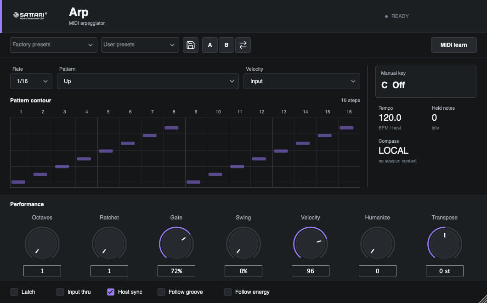
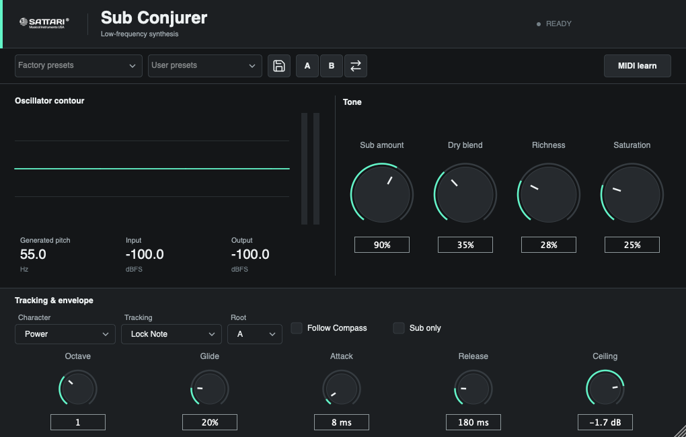
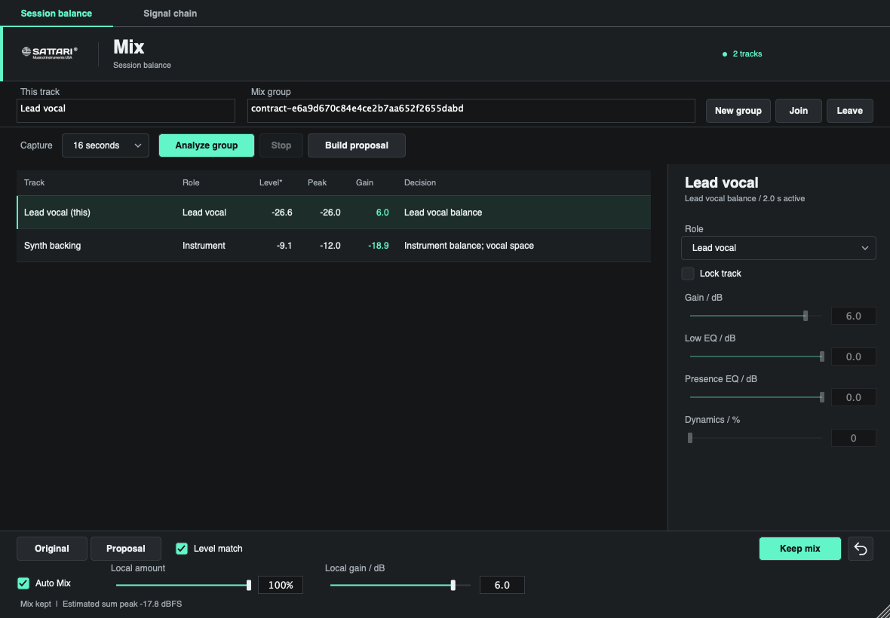
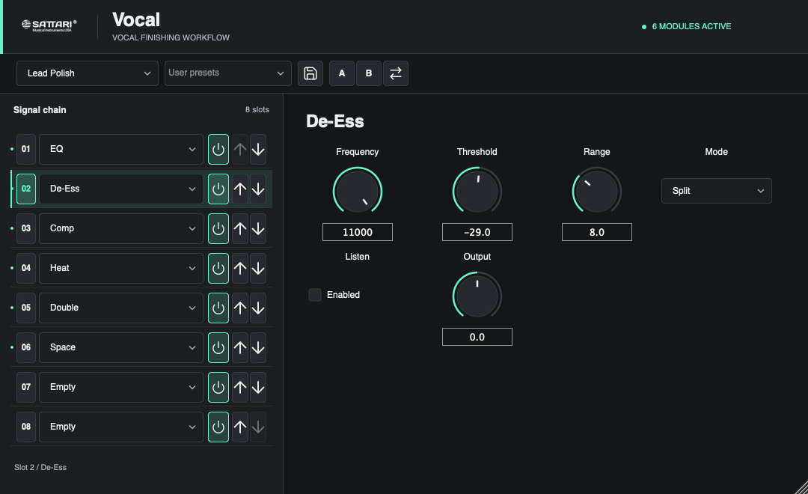
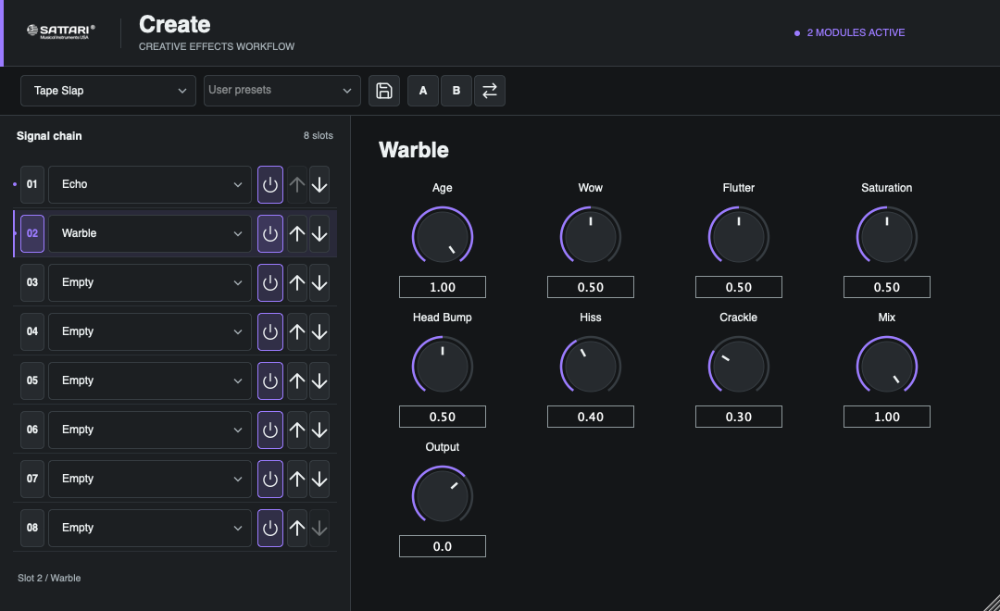

# Release-Candidate UI Overhaul

Date: 2026-09-28. Scope: the five candidates from the suite scan, not every plugin.
These are internal test builds, not public-release-qualified products.

| Product | Version | Formats |
| --- | --- | --- |
| Sattari Arp | 0.1.1 | AU MIDI effect, VST3 |
| Sub Conjurer | 0.1.1 | AU, VST3, Standalone |
| Sattari Mix | 0.2.1 | AU, VST3, Standalone |
| Sattari Vocal | 0.1.1 | AU, VST3, Standalone |
| Sattari Create | 0.1.1 | AU, VST3, Standalone |

## What Changed

- A shared flat studio-console theme with native keyboard focus, tooltips,
  numeric entry, restrained product accents and Lucide command icons.
- Arp: pattern contour, rate/pattern/velocity fields, key and session status,
  seven performance controls and transport-follow options.
- Sub Conjurer: oscillator contour, input/output levels, four primary tone
  controls and a dedicated tracking/envelope area. Percent, millisecond and
  decibel displays retain the original raw parameter values.
- Mix: session-balance table, selected-track inspector, group capture controls,
  proposal audition/keep/undo and a separate signal-chain tab.
- Mix, Vocal and Create: numbered chain selection, paired module/bypass
  reordering, power controls and a scrollable rotary parameter inspector.
- Existing factory/user presets, A/B comparison and MIDI learn where supported
  remain available. Failed preset reads/writes report an error.

Plugin identities, parameter IDs/order and DSP were not changed by this UI pass.
Rack modules still have shared per-module controls, with only the first active
occurrence processing audio; the editor explicitly reports inactive duplicates.
The Arp pattern contour and Sub oscillator contour are illustrative displays
derived from state, not recorded note-history or captured audio waveforms.

## Verification

**Result: 50/50 qualification commands passed.** All five AU validations and all
five VST3 pluginval runs at strictness 5 passed. All 14 bundles have both arm64
and x86_64 slices, matching versions and valid ad-hoc signatures. The 10 UI runs
(five native, five Rosetta) and seven processor/regression contracts passed.

`final-build.log` and `polish-build.log` record the universal Release build. `qualify.py` runs fresh
checks and records command lines, exit codes and durations in `results.json`.
This is separate from the earlier whole-suite cached-test inventory.

The five new UI contracts cover minimum/default/maximum dimensions, control
bounds, nonblank rendering, preset interaction and actual parameter edits.
Rack checks also verify module/bypass pairing during reorder. Each UI contract
is run natively and under Rosetta. Seven processor/regression contracts cover
Arp timing, Sub synthesis, the three racks, Mix automixing and rack behavior.
Bundle gates check architecture slices, versions, signatures, AU validation and
VST3 pluginval strictness 5. See the individual logs for measured outcomes.
The architecture harness initially used the wrong `lipo` argument order; it was
corrected and all 14 architecture checks were rerun successfully. No plugin
change was needed for that harness issue.

Native editor screenshots are below. Mix's populated screenshot uses synthetic
contract fixtures, not a real musical session or evidence of listening quality.

### Arp

### Sub Conjurer

### Mix

### Vocal

### Create

## Remaining Release Gates

- Manual target-DAW sessions: opening/resizing, keyboard focus, automation,
  MIDI routing, editor reopen, preset recall, project save/reopen and long runs.
- Real-material listening, loudness-matched evaluation and cleared test corpus.
- Developer ID signing, notarization, installer and clean-machine verification.
- License/commercial-distribution review per the repository's licensing policy.

These checks do not establish industry-leading audio quality or sale readiness.
