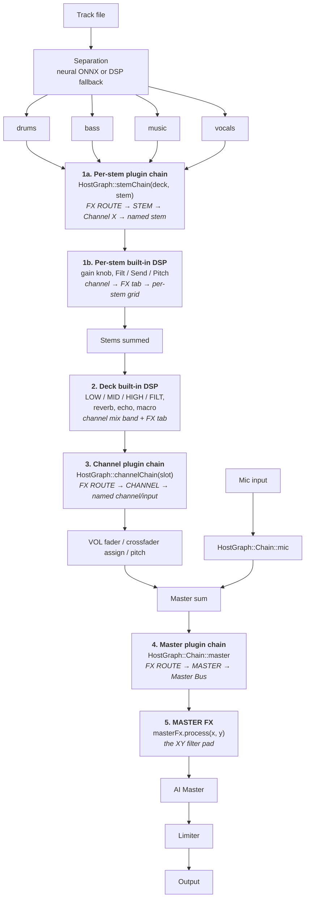

# StemDeck FX signal path

There are three places in the UI that say "FX", and until you have this diagram
it is genuinely unclear which one to reach for. This document is the answer to
"how do I put a filter on the vocal stem of channel B?" — and the honest answer
is that there are **two different right answers** depending on whether you want
the built-in DSP or a hosted plugin.

Traced from source, not from memory:
`MainPluginProcessor.cpp` (`onStemFx`, `onPostBody`, the master stage) and
`HostGraph.h` (`Chain`, `stemChain`).

## The path

## Which control do I reach for?

| I want to… | Go to |
|---|---|
| Filter one stem, built-in, zero latency | Channel → **FX** tab → per-stem grid, `Filt` row, `VO` column |
| Put a *plugin* on one stem | **FX ROUTE** → **STEM** → channel → named stem → **add FX** |
| Filter the whole channel | Channel → mix band → `FILT` knob |
| Put a *plugin* on the whole channel or input | **FX ROUTE** → **CHANNEL** → named destination → **add FX** |
| Sweep a filter over the whole mix, by hand | **MASTER FX** XY pad |
| Put a *plugin* across the mix | **FX ROUTE** → **MASTER** → **add FX** |

## Important distinction

The selected plugin destination is stored by stable HostGraph chain identity.
Changing the focused deck does not change it. If a channel is removed, the rack
falls back to the Master Bus instead of silently selecting another channel.

"FX" still covers two mechanisms. The channel FX tab is **built-in
DSP** — parameters on the deck, captured in the event stream, always present.
FX ROUTE is a **plugin host** — trusted plugins in an `AudioProcessorGraph`, absent if
nothing is loaded. They are not alternatives to each other and they compose in a
fixed order: per-stem plugin → per-stem DSP → deck DSP → deck plugin.

## Chain identity is persisted — do not renumber

`HostGraph::Chain` values are written into saved state. The 16 stem chains are
appended **after** `master` precisely so the six original ids keep their numeric
values. Renumbering silently reassigns a user's FX to a different chain on load.
